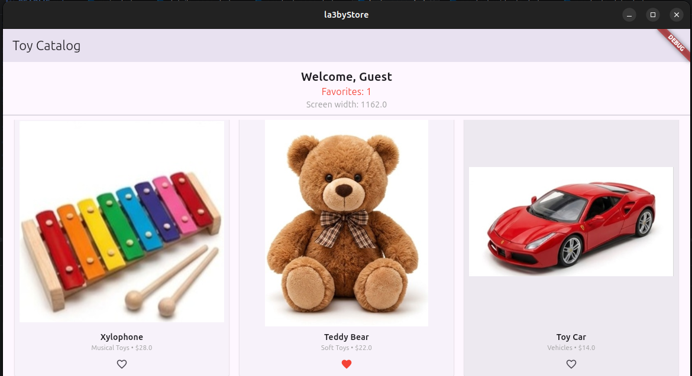
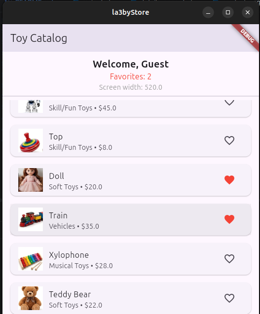

# La3byStore

**La3byStore** is a modern, responsive Flutter mini product catalog application designed to demonstrate advanced Flutter navigation patterns with `go_router`, responsive layout switching (`ListView` vs `GridView`), and comprehensive widget lifecycle management.

---

## Key Features

* **Declarative Routing (`go_router`):** Clean URL-based routing supporting path parameters (`/details/:name/:price`) and query parameters (`/products?user=Guest`).
* **Responsive Layout:** Automatically switches between a **List View** (for mobile screens $< 600\text{px}$) and a **Grid View** (for tablets and desktop screens $\ge 600\text{px}$) using `MediaQuery`.
* **Interactive Catalog:**
* Real-time **Favorites** counter and toggle tracking.
* Product detail views with dynamic pricing and stock info.
* **Add to Cart** action that returns confirmation results back to the catalog view using route popping (`context.pop`).


* **Lifecycle & State Logging:** Detailed tracking of widget lifecycle methods (`initState`, `didChangeDependencies`, `deactivate`, `dispose`) and window resize handling.

---

## App Screenshots





---
## Project Architecture

```text
La3byStore/
├── assets/                  # Product images & static assets
│   ├── airplane.jpg
│   ├── ball.jpg
│   └── ...
├── lib/
│   ├── main.dart            # App entry point, GoRouter config, & Q&A documentation
│   ├── login_page.dart      # Authentication / Entry screen
│   ├── product_page.dart    # Main catalog screen with responsive view switcher
│   ├── details_page.dart    # Product details & cart action screen
│   ├── product_widgets.dart # Reusable ProductsListView & ProductsGridView widgets
│   └── products_data.dart   # Mock toy product dataset
├── pubspec.yaml             # Dependencies & asset configuration
└── README.md                # Project documentation

```

---

## Navigation & Routing Mechanics

La3byStore replaces traditional Navigator 1.0 imperative navigation with modern **`go_router`** declarative routing:

| Navigation Flow | Route Type | Method Used | Description |
| --- | --- | --- | --- |
| **Login $\rightarrow$ Products** | Query Parameter | `context.goNamed` | Replaces the stack so users cannot press the hardware back button to return to the login screen. Passes user state via query string (`?user=Guest`). |
| **Products $\rightarrow$ Details** | Path Parameter | `context.push` | Pushes a temporary details view onto the stack while preserving the current catalog state and allowing return via back button. |

---

## Built With

* **Framework:** [Flutter](https://flutter.dev/) (SDK $\ge 3.0$)
* **Language:** [Dart](https://dart.dev/)
* **Routing:** [`go_router`](https://pub.dev/packages/go_router) package
* **State Management:** Flutter Stateful Widgets & `setState`

---

## Getting Started

Follow these instructions to get a local copy up and running on your machine.

### Prerequisites

* Ensure you have the [Flutter SDK](https://docs.flutter.dev/get-started/install) installed.
* Git installed on your system.

### Installation & Execution

1. **Clone the repository:**
```bash
git clone https://github.com/hagarabseed/La3byStore.git
```


2. **Navigate into the project directory:**
```bash
cd La3byStore
```


3. **Install dependencies:**
```bash
flutter pub get
```


4. **Run the application:**
```bash
flutter run
```
---
### - Under the supervision of:
- Eng. Atef Mousa, Teaching assistant at the Faculty of AI, Software Development for Mobile Devices Course

By: Hagar Mahmoud Ahmed.

